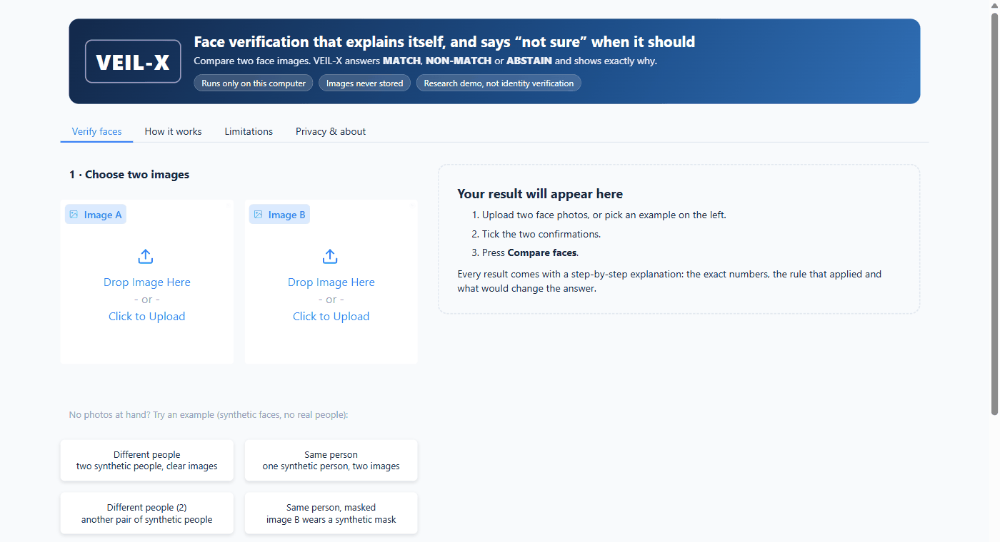
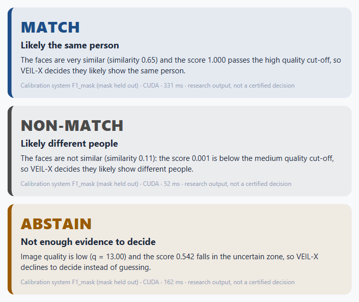
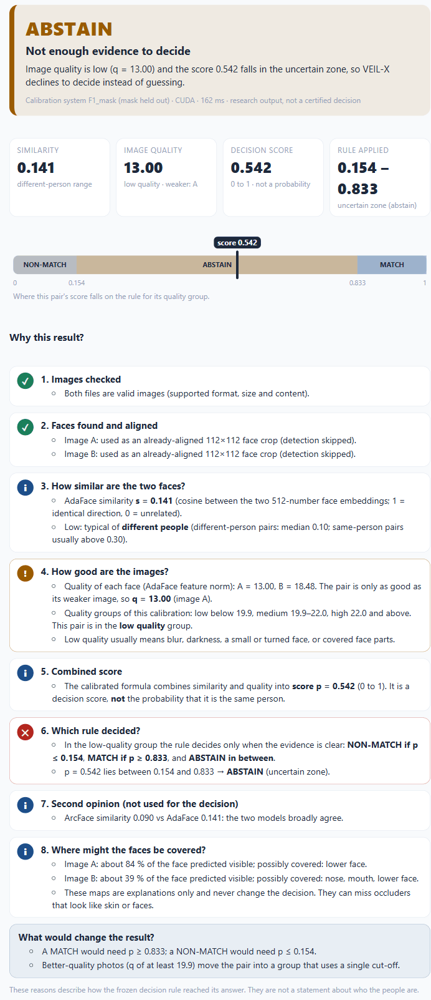
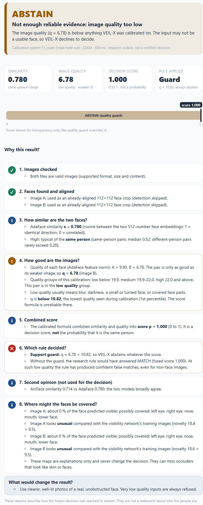
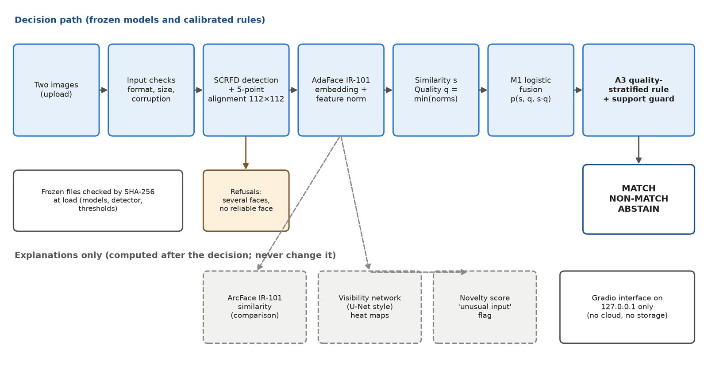
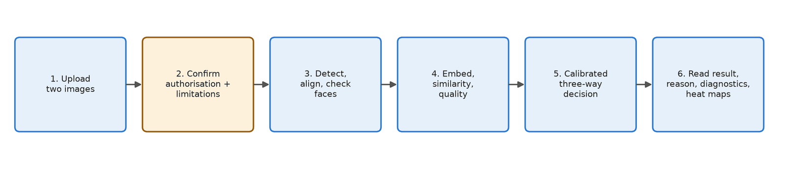
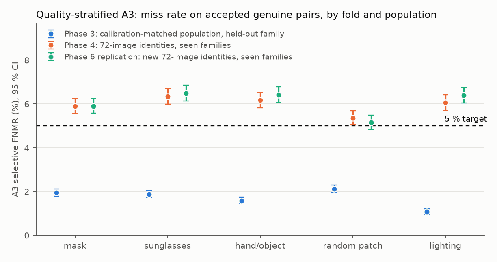
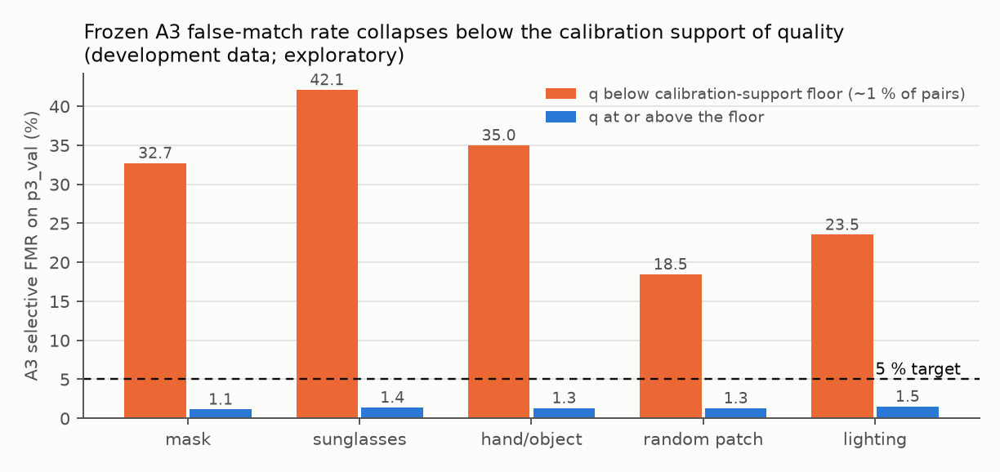

# VEIL-X

### An AI-Based Face Verification System with Quality Assessment and Intelligent Abstention

[](https://github.com/MeezaUni/VEIL-X/actions/workflows/ci.yml)


VEIL-X is a **local AI application that compares two face images** and reports whether they
are likely to show the same person. Unlike a basic face matcher, it can answer in three ways:

| **MATCH** | **NON-MATCH** | **ABSTAIN** |
|---|---|---|
| Strong evidence of the same person | Strong evidence of different people | Not enough reliable evidence, so the system declines and explains why |

It measures **image quality**, uses **calibrated thresholds** and shows **diagnostics and
visibility heat maps** for every comparison. Everything runs on your own computer: no cloud and
no stored images.

> **Academic demonstration only.** VEIL-X is a university course project, not a certified
> identity-verification product. Do not use it for identification, access control, surveillance
> or any decision affecting people. Use only images you are authorised to process.



---

## Contents

- [Features](#features)
- [Quick start (Windows, one click)](#quick-start-windows-one-click)
- [Screenshots](#screenshots)
- [How it works](#how-it-works)
- [Results](#results)
- [Limitations](#limitations)
- [Manual installation (developers)](#manual-installation-developers)
- [Repository structure](#repository-structure)
- [Documentation](#documentation)
- [Privacy, ethics and licences](#privacy-ethics-and-licences)

---

## Features

- **Two-image verification.** Pretrained deep face models: SCRFD detection and AdaFace IR-101
  embeddings.
- **Quality assessment.** The embedding's feature norm measures image quality and selects the
  decision thresholds.
- **Three-way decisions.** MATCH / NON-MATCH / ABSTAIN, with thresholds calibrated on separate
  data.
- **Explains every decision.** A plain-language **Why this result?** panel walks through each
  step with the exact numbers: faces found, similarity (compared with typical same-person and
  different-person values), image quality group, the score, the exact threshold comparison that
  decided, and **what would change the result**. Visibility heat maps, an "unusual input" flag
  and a second-model opinion are shown for context only.
- **Safe defaults.**
  - Several faces are refused unless you choose one.
  - Unsuitable photos are refused.
  - Very low-quality inputs abstain (the support guard).
- **Private.** Runs only on `127.0.0.1`, blocks third-party requests, deletes uploads after
  reading and stores no faces or embeddings.
- **Tested.** 400+ automated tests. The app reproduces the research pipeline exactly
  (1,000 / 1,000 decisions).

---

## Quick start (Windows, one click)

**Requirements:**
- Windows 10 or 11, about **6 GB** of free disk space;
- an internet connection for the first run only;
- an NVIDIA GPU is optional; without one VEIL-X runs on the CPU, a little slower.

1. **Download the code.** On GitHub, click **Code → Download ZIP**, then extract the ZIP to a
   folder, for example `C:\VEIL-X`.
2. **Add the runtime pack.**
   - Get **`VEIL-X_runtime_pack.zip`** (about 80 MB) from the project owner.
   - Put it, still zipped, **next to `run_veilx.bat`** in the extracted folder.
   - It contains the frozen decision files and demo images that are not published on GitHub.
3. **Double-click `run_veilx.bat`.**
   - **First run** (5–15 minutes): it unpacks the runtime pack and installs Python 3.12 and all
     libraries in a private `.venv-app` folder. Your system Python is not touched. It then
     downloads the two face-recognition models (about 520 MB) and checks their fingerprints.
   - **Later runs** start in a few seconds.
   - Your browser opens at **http://127.0.0.1:7860**. Keep the black window open while you use
     the app.
4. **Try it.**
   - Click an example button under the upload boxes, for example **Same person**.
   - Tick both confirmation boxes, then click **Compare faces**.
   - Read the result card and the **Why this result?** steps underneath.

   | Example button | Expected result |
   |---|---|
   | Same person | **MATCH** |
   | Different people | **NON-MATCH** |
   | Same person, masked | **ABSTAIN** (low quality, uncertain zone) |
   | Not a face (noise) | **ABSTAIN** (support guard) |

   To use your own photos, drop two images into **Image A** and **Image B**. Each upload is
   checked at once, and you can compare again with other options without re-uploading.

`run_veilx.bat` uses [uv](https://docs.astral.sh/uv/) to install Python. If uv is missing, it
asks before installing it.

| Problem | Fix |
|---|---|
| "The VEIL-X runtime pack was not found" | Put `VEIL-X_runtime_pack.zip` next to `run_veilx.bat` |
| Port 7860 already in use | `run_veilx.bat --port 7861`, then open `http://127.0.0.1:7861` |
| No NVIDIA GPU, or GPU errors | `run_veilx.bat --device cpu` |
| Setup interrupted or broken | Delete the `.venv-app` folder and run `run_veilx.bat` again |
| Windows SmartScreen warning | Click *More info → Run anyway*. The script is plain text; you can open it in Notepad to read it first |

A five-minute demonstration script is in [`docs/university/demo_guide.md`](docs/university/demo_guide.md).

---

## Screenshots

The face examples in the app are synthetic, computer-generated DigiFace-1M faces, not real
people. The screenshots below show only interface elements, so no faces appear.

**Three decision outcomes** (real outputs of the app on the built-in examples):



**Why this result?** The full explanation for the masked example: the quality is low, so the
low-quality rule applies, and the score falls inside its uncertain zone:



**Support guard.** Two random-noise images are refused (ABSTAIN), and the app states that the
unguarded rule would have said MATCH:



---

## How it works



1. **Check the files:** format, size, corruption.
2. **Find and align the face.**
   - SCRFD detects the face and five landmarks, and the face is aligned to a standard 112×112
     crop.
   - Several faces → you must choose one.
   - No reliable face → refused.
3. **Embed.** AdaFace IR-101 (pretrained) turns each face into 512 numbers. The length of that
   vector, the *feature norm*, is a built-in **quality** score.
4. **Compare.** Cosine similarity *s* between the two faces; pair quality *q* is the weaker image's
   norm.
5. **Score.** A small logistic formula combines *s*, *q* and *s·q* into a score between 0 and 1.
   The score is **not** a probability of identity.
6. **Decide.**
   - The pair's quality selects low, medium or high thresholds, calibrated with the
     Learn-then-Test method.
   - Low-quality pairs have an **abstention band**.
   - Below the calibrated quality range the app always abstains (the support guard).
7. **Explain.** Diagnostics, abstention reasons and visibility heat maps. ArcFace similarity and
   the visibility network are shown as **explanations only**; they never change the decision.



**Pretrained versus built here:**
- **Pretrained:** AdaFace, ArcFace (WebFace4M) and SCRFD.
- **Built or trained in this project:**
  - the visibility network (a small U-Net);
  - the logistic fusion and the calibrated thresholds;
  - the application, server and test suite.

**Technology:**
- Python 3.12, PyTorch (CUDA), ONNX Runtime, OpenCV;
- Gradio + FastAPI (localhost only);
- pytest, Ruff, strict mypy and GitHub Actions.

---

## Results

All numbers come from committed result files in `reports/experiments/`.

| Check | Result |
|---|---|
| App vs research pipeline | **1,000 / 1,000** identical decisions; CPU vs GPU 100 / 100 |
| Speed (RTX 4060 Laptop, warm, median) | **226 ms** per photo pair; 43 ms per pre-aligned pair; CPU-only 0.3–0.5 s |
| Automated tests | 415 (CPU) + 430 (GPU) passing, plus lint, strict typing and a privacy scan |
| Unseen occluder, data like the calibration data | Selective errors 1.1–2.6 % at 89–97 % coverage (target ≤ 5 %) |

The parity figure means the app reproduces the research system exactly. It is **not** a
recognition-accuracy figure.

**Population shift.** The 5 % target held on data like the calibration data. On a harder group
of synthetic identities it did not. A pre-registered repeat on 4,000 new identities confirmed this
(4 of 5 configurations above target):



**Low-quality inputs.**
- Below the calibrated quality range (about 1 % of pairs), the research rule produced 22.97 %
  false matches on new test data, against 1.50 % above it.
- Even random noise scored 1.000.
- This is why the app abstains there. It is an application safeguard, not a proven universal
  fix.



---

## Limitations

- **Synthetic test data.** Main tests used synthetic faces and synthetic occlusions. Real
  physical occlusions were not evaluated.
- **Population-dependent calibration.** Thresholds must be re-calibrated for each new population
  and camera.
- **Low-quality inputs.** These are guarded only in the app.
- **No single calibration.** Five calibration configurations exist; none is universal.
- **Learned visibility** failed on unseen occluder types, so it is used only as an explanation.
- **Not certified.** Not suitable for real identity decisions.

---

## Manual installation (developers)

```powershell
# environments (uv: https://docs.astral.sh/uv/)
uv venv --python 3.12 .venv-gpu
uv pip install --python .venv-gpu\Scripts\python.exe torch --index-url https://download.pytorch.org/whl/cu128
uv pip install --python .venv-gpu\Scripts\python.exe -e ".[gpu,app]" pytest

# data folder: runtime pack extracted as .\veilx_data (or any folder), plus the public models
$env:VEILX_DATA_ROOT = "$PWD\veilx_data"
.venv-gpu\Scripts\python.exe scripts\fetch_models.py
.venv-gpu\Scripts\python.exe scripts\run_app.py --open-browser    # http://127.0.0.1:7860

# checks
.venv-gpu\Scripts\python.exe scripts\smoke_test.py                 # no biometric data needed
uv venv --python 3.12 .venv; uv pip install --python .venv\Scripts\python.exe -e . pytest ruff mypy types-PyYAML
.venv\Scripts\python.exe scripts\quality_gate.py                   # lint, types, tests, privacy scan
```

**For the project owner: building the runtime pack.** This uses the private data folder:

```powershell
$env:VEILX_DATA_ROOT = "C:\path\to\veilx_data"
.venv-gpu\Scripts\python.exe scripts\make_runtime_pack.py   # -> deliverables\VEIL-X_runtime_pack.zip
```

- The script verifies every file against the frozen SHA-256 fingerprints before packing.
- Share the pack **privately**: it contains research-licensed model files and synthetic demo
  images. Never commit it.

Full reproduction of the experiments is described in
[`docs/reproducibility.md`](docs/reproducibility.md).

---

## Repository structure

```
run_veilx.bat        one-click launcher (Windows)
configs/             frozen app configuration, research protocol, experiment configs
src/veilx/           package: app (UI, pipeline, decision, diagnostics), models, data, stats ...
scripts/             app launcher, runtime pack, experiments, evaluation, quality gate
tests/               400+ unit, integration and privacy tests
docs/                user guide, university deliverables, research record, images
reports/             committed result files (aggregates only) and figures
```

---

## Documentation

**University course project** ([`docs/university/`](docs/university/)):
- [report](docs/university/report.md);
- [demo guide](docs/university/demo_guide.md);
- [viva questions](docs/university/viva_questions.md);
- [one-page summary](docs/university/project_summary.md).

The formatted DOCX / PDF / PPTX versions are built by `scripts/build_university_deliverables.py`.

**Using the app:** [`docs/app_user_guide.md`](docs/app_user_guide.md),
[`docs/calibration_systems.md`](docs/calibration_systems.md).

**Research record** (full detail, including negative findings):
- [`docs/paper/veilx_paper.md`](docs/paper/veilx_paper.md);
- results for each phase, from [`docs/phase3_results.md`](docs/phase3_results.md) to
  [`docs/phase6_results.md`](docs/phase6_results.md);
- the claim-to-evidence audit [`docs/phase6_audit.md`](docs/phase6_audit.md);
- the decisions in [`docs/decision_log.md`](docs/decision_log.md).

---

## Privacy, ethics and licences

**Scope and privacy:**
- 1:1 verification of two images only. There is no database, no search and no identification
  feature.
- No face images, embeddings, identity lists, model weights or credentials are stored in this
  repository; a privacy scanner enforces this on every commit.
- The app runs only on `127.0.0.1` and deletes uploads after reading.

**Data and model licences** (all non-commercial research use):
- DigiFace-1M (synthetic faces): research licence.
- LFW: used only for follow-up research checks, under academic authorisation; not
  redistributed.
- Pretrained models: AdaFace / ArcFace (CVLface releases) and SCRFD (InsightFace).

**Code:** MIT.

**Key references:**
- Kim et al., *AdaFace*, CVPR 2022;
- Deng et al., *ArcFace*, CVPR 2019;
- Guo et al., *SCRFD*, ICLR 2022;
- Bae et al., *DigiFace-1M*, WACV 2023;
- Angelopoulos et al., *Learn then Test*, arXiv:2110.01052.
